# Sellable RAG — Implementation Progress

Source architecture: [Sellable_RAG_Product_Architecture.md](../Architecture/Sellable_RAG_Product_Architecture.md)

## Phase Status Tracker

Status legend: ⬜ Not started · 🟨 In progress · ✅ Done · ⛔ Blocked

| # | Phase | Status | Plan |
|---|---|---|---|
| 0 | Foundation and Skeleton | 🟨 | [phase_00_foundation.md](phase_00_foundation.md) |
| 1 | Knowledge Plane I — Ingestion, Parsing, Chunking | ⬜ | [phase_01_ingestion_parsing.md](phase_01_ingestion_parsing.md) |
| 2 | Knowledge Plane II — Embeddings and Indexing | ⬜ | [phase_02_embeddings_indexing.md](phase_02_embeddings_indexing.md) |
| 3 | Query Plane I — Baseline RAG + Minimal Chat | ⬜ | [phase_03_baseline_rag.md](phase_03_baseline_rag.md) |
| 4 | Evaluation Harness | ⬜ | [phase_04_evaluation.md](phase_04_evaluation.md) |
| 5 | Auth, Multi-Tenancy, Permission Filter | ⬜ | [phase_05_auth_tenancy_permissions.md](phase_05_auth_tenancy_permissions.md) |
| 6 | Query Plane II — Advanced Retrieval and Grounding | ⬜ | [phase_06_advanced_retrieval.md](phase_06_advanced_retrieval.md) |
| 7 | Versioning and Document Lifecycle | ⬜ | [phase_07_versioning_lifecycle.md](phase_07_versioning_lifecycle.md) |
| 8 | Observability and Cost Tracking | ⬜ | [phase_08_observability_cost.md](phase_08_observability_cost.md) |
| 9 | Security Hardening | ⬜ | [phase_09_security.md](phase_09_security.md) |
| 10 | Streamlit Product UI | ⬜ | [phase_10_streamlit_ui.md](phase_10_streamlit_ui.md) |
| 11 | GCP Production Deployment and Scale | ⬜ | [phase_11_gcp_production.md](phase_11_gcp_production.md) |

```mermaid
flowchart LR
  P0["P0 Foundation"] --> P1["P1 Ingestion and Parsing"]
  P1 --> P2["P2 Embeddings and Indexing"]
  P2 --> P3["P3 Baseline RAG + Chat UI"]
  P3 --> P4["P4 Evaluation Harness"]
  P4 --> P5["P5 Auth, Tenancy, Permissions"]
  P5 --> P6["P6 Advanced Retrieval and Grounding"]
  P6 --> P7["P7 Versioning and Lifecycle"]
  P7 --> P8["P8 Observability and Cost"]
  P8 --> P9["P9 Security Hardening"]
  P9 --> P10["P10 Streamlit Product UI"]
  P10 --> P11["P11 GCP Production and Scale"]
```



---

## Confirmed Stack

| Concern | Choice |
|---|---|
| API | FastAPI (`/v1` versioned), Pydantic v2 |
| Relational DB | PostgreSQL (Cloud SQL in prod) + SQLAlchemy 2 + Alembic |
| Keyword search | Postgres full-text (`tsvector` + GIN index) |
| Vector search | Qdrant (Docker locally → Qdrant Cloud on GCP / self-hosted on GCE in prod) |
| Queue / cache | Redis (Memorystore in prod) + **Dramatiq** workers |
| LLM + embeddings | Google Gemini (`google-genai` SDK, `gemini-embedding-001`) |
| Object storage | Local filesystem in dev → Google Cloud Storage in prod |
| Documents | PDF, DOCX |
| UI | Streamlit (calls only the public API) |
| Deploy | Docker Compose locally → Cloud Run (API + worker) on GCP |

> **Why Dramatiq instead of RQ:** RQ depends on `fork()` and doesn't run natively on Windows. Dramatiq works on Windows, retries failed jobs, and runs fine in containers on Cloud Run.

---

## The "No-Crash" Contract (applies to every phase)

These rules are how each phase builds on the last without breaking it.

1. **Ports & adapters.** Every external system (Qdrant, Postgres FTS, Gemini, GCS, Redis) sits behind a Python `Protocol` interface. A new phase adds a new adapter or stage. It doesn't rewrite the code that calls it.
2. **Build the schema first, switch behaviour on later.** `tenant_id`, `document_version`, `embedding_model` and `acl` columns exist **from Phase 0/1**, filled with defaults. Later phases start using them.
3. **Additive-only migrations.** Use expand → migrate → contract. Never drop or rename a column in the same phase that stops using it.
4. **Pipelines built from stages.** The query plane is a list of stages that all take the same `QueryContext` object. A new stage is inserted as a step. Its default is a no-op.
5. **Feature flags per tenant.** New retrieval or generation behaviour ships switched **off** and is turned on only after it passes evaluation.
6. **API stability.** `/v1` responses only gain *optional* fields. Breaking changes go to `/v2`.
7. **Regression gates grow every phase.** Tests from earlier phases stay in CI. From Phase 4 on, there is also an **evaluation quality gate**.

### Phase completion rule

A phase is marked ✅ only when:
- every task checkbox in its file is ticked,
- all of its exit criteria are met,
- the **full** test suite from all earlier phases still passes,
- (from Phase 4 on) eval scores have not dropped below the stored baseline.

---

## Target Code Layout (modular monolith)

```text
src/advance_rag/
  core/            # config, logging, db session, request context, errors
  infra/           # adapters: storage, qdrant, pg_search, gemini, redis
  tenancy/         # tenant model, tenant context, quotas
  auth/            # API keys / JWT, users, groups, ACL
  ingestion/       # upload, parsing, chunking, metadata, embedding, indexing tasks
  retrieval/       # query understanding, permission filter, vector/keyword/hybrid
  ranking/         # rerankers
  generation/      # context builder, prompts, LLM call, citations/grounding
  evaluation/      # datasets, metrics, runners
  observability/   # tracing, metrics, cost tracking
  api/v1/          # FastAPI routers
  workers/         # Dramatiq broker + actor registration
ui/streamlit_app/  # Streamlit client (API consumer only)
migrations/        # Alembic
tests/{unit,integration,e2e}/
eval/datasets/     # golden Q&A sets (PostEx first)
docker-compose.yml
```

---

## Open Questions

- [ ] **Language:** Are PostEx documents or queries only in English, or also **Urdu / Roman Urdu**? This decides the FTS dictionary (`english` vs `simple`).
- [ ] **Scanned PDFs:** Are any PDFs scanned images? If so, Phase 1 needs an OCR adapter (Document AI / Gemini multimodal).
- [ ] **Tenant model:** One tenant per enterprise client with departments as groups, or sub-tenants (workspaces)?
- [ ] **Permissions source:** Will ACLs be managed in your app, or synced from Google Workspace / SharePoint / AD? Syncing would add a connectors phase.
- [ ] **Python version:** OK to drop to 3.12/3.13 if a key library lacks 3.14 support?
- [ ] **Eval data:** Can someone at PostEx write 50–100 real Q/A pairs for Phase 4?

## Change Log

| Date | Change |
|---|---|
| 2026-10-07 | Initial phased plan created |
